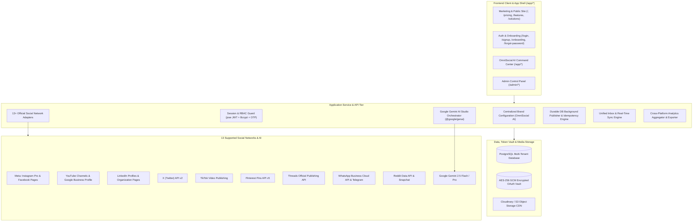

# OmniSocial AI — Master Architecture, Feature & Capability Specification

> **Platform**: OmniSocial AI — Next-Generation AI Social Media Intelligence & Publishing Platform  
> **Architecture Version**: 3.0.0 (Enterprise Specification)  
> **Brand**: OmniSocial AI  
> **AI Provider**: Google Gemini (`@google/genai`)  
> **Persistence**: PostgreSQL Multi-Tenant DB via Prisma ORM & AES-256 GCM Encrypted Vault  

---

## 1. Executive System Summary

**OmniSocial AI** is a production-oriented, enterprise-grade social media management software platform engineered to provide creators, agencies, marketing teams, and enterprise brands with one unified command center to compose, schedule, publish, monitor, analyze, and automate multi-platform social media campaigns.

---

## 2. Brand Identity & Design System

### 2.1 Brand Personality & Identity
- **Brand Name**: OmniSocial AI (configurable via `src/lib/brand-config.ts`).
- **Personality**: Intelligent, Creative, Reliable, Modern, Enterprise-Ready, Friendly.
- **Custom Wordmark & Logo**:
  - Custom SVG emblem combining continuous multi-network orbital nodes, creation flow ribbons, and a radiant 4-pointed AI intelligence spark.
  - Full horizontal logo, compact icon-only version, and sidebar collapsed version.
  - Light mode variant (`#059669` emerald & `#0D9488` teal on `#FAFAF9` warm off-white surface).
  - Dark mode variant (`#10B981` emerald & `#14B8A6` teal with glowing coral `#FB7185` on `#09090B` neutral dark surface).
  - Subtle load animation respecting `prefers-reduced-motion: reduce`.
  - SVG Favicon at `public/icon.svg`.

### 2.2 Visual Design System Tokens
- **Surfaces**: Warm off-white (`#FAFAF9` / `#F5F5F4` / `#FFFFFF`) and neutral dark (`#09090B` / `#121214` / `#18181B`).
- **Typography**: Charcoal (`#18181B` / `#27272A` / `#52525B`) for high contrast readability.
- **Primary Accents**: Emerald (`#059669` / `#10B981`) and Teal (`#0D9488` / `#14B8A6`).
- **Action Buttons / CTAs**: Warm Coral (`#F43F5E` / `#E11D48`).
- **Accessibility**: WCAG AAA/AA contrast compliance, visible focus rings (`focus:ring-2 focus:ring-emerald-500/50`), and keyboard accessibility.

---

## 3. Supported Social Media Platforms & Capability Matrix

OmniSocial AI strictly integrates with official vendor APIs without scraping.

| Platform | Official API Tier | Direct Publishing | Scheduling | Media Supported | Character Limit | Live Analytics | Unconfigured State Action |
|:---|:---|:---:|:---:|:---|:---:|:---:|:---|
| **Instagram** | Graph API v21.0 | ✅ Yes | ✅ Yes | Image, Video, Carousel, Reels | 2,200 | ✅ Yes | Connect Meta Business Account |
| **Facebook Pages** | Graph API v21.0 | ✅ Yes | ✅ Yes | Image, Video, Carousel, Reels | 63,206 | ✅ Yes | Connect Facebook Page |
| **YouTube** | Data API v3 | ✅ Yes | ✅ Yes | Video, Shorts | 5,000 | ✅ Yes | Connect Google Cloud OAuth |
| **LinkedIn** | Community Mgmt API | ✅ Yes | ✅ Yes | Text, Image, Video, Doc | 3,000 | ✅ Yes | Connect LinkedIn App |
| **X (Twitter)** | Twitter API v2 | ✅ Yes | ✅ Yes | Text, Image, Video | 280 (25k Premium) | ✅ Yes | Connect X Developer Project |
| **TikTok** | Content Posting API | ✅ Yes | ✅ Yes | Video | 2,200 | ✅ Yes | Connect TikTok Partner App |
| **Pinterest** | Pinterest API v5 | ✅ Yes | ✅ Yes | Pins, Video Pins | 500 | ✅ Yes | Connect Pinterest Business App |
| **Threads** | Threads API v1.0 | ✅ Yes | ✅ Yes | Text, Image, Video | 500 | ✅ Yes | Connect Threads Profile |
| **Google Business** | Performance API | ✅ Yes | ✅ Yes | Updates, Offers, Events | 1,500 | ✅ Yes | Connect Google Location |
| **WhatsApp Business** | Cloud API v19.0 | ✅ Yes (Templates) | ✅ Yes | Message, Image, Doc | 4,096 | ✅ Yes | Provide Phone ID & Token |
| **Telegram** | Bot API | ✅ Yes | ✅ Yes | Text, Photo, Video, Doc | 4,096 | ✅ Yes | Provide Bot Token |
| **Reddit** | Data API | ✅ Yes | ✅ Yes | Text, Link, Image | 40,000 | ✅ Yes | Connect Reddit App |
| **Snapchat** | Creative Kit / Ads | ⚠️ Partner Restricted | ⚠️ Scheduled | Vertical Video, Image | 250 | ✅ Yes | Apply for Snap Partner Access |

---

## 4. Route Topology (`/app/*` Route Architecture)

All core application workflows operate under the primary `/app/*` route suite with backward compatibility for legacy links:

- `/` — Public Marketing Home
- `/login` — Secure Authentication
- `/signup` — Account Creation & Tenant Provisioning
- `/forgot-password` — Password Recovery & OTP
- `/onboarding` — Interactive 3-Step Workspace Setup Wizard
- `/app` — Workspace Overview Command Center
- `/app/accounts` — Connected Social Accounts & Capability Diagnostics
- `/app/publish` — Universal Multi-Platform Composer
- `/app/calendar` — Content Calendar & Rescheduling
- `/app/drafts` — Draft Post Management
- `/app/published` — Published Content Archive & Engagement
- `/app/queue` — Scheduled Publishing Queue
- `/app/inbox` — Unified Social Inbox (Comments, Mentions, DMs)
- `/app/analytics` — Historical Analytics & Engagement Trends
- `/app/reports` — Reporting & Export (CSV/PDF)
- `/app/ai-studio` — Dedicated 8-Step Google Gemini AI Studio
- `/app/media` — Cloud Media Asset Library
- `/app/approvals` — Content Approvals Workflow & RBAC Gates
- `/app/team` — Team & Role Management
- `/app/campaigns` — Multi-Channel Campaign Coordination
- `/app/settings` — Personal & Workspace Settings
- `/app/billing` — Subscription Management & Usage Limits
- `/admin` — Protected Enterprise Administration Panel
- `/privacy` — Privacy Policy
- `/terms` — Terms of Service

---

## 5. Advanced AI Content Studio (Google Gemini)

OmniSocial AI integrates **Google Gemini** (`@google/genai`) via a secure, server-side abstraction layer with zero browser credential exposure.

### 8-Step AI Studio Workflow
1. **Content Objective**: Select from 6 goal archetypes (Audience Growth, Engagement, Conversions, Launch, Education, Storytelling).
2. **Target Channels**: Multi-select target platforms (Instagram, LinkedIn, X, Facebook, YouTube, TikTok, Pinterest, Threads).
3. **Topic & Context**: Enter seed ideas, article links, product angles, or raw drafts.
4. **Persona & Brand Voice**: Fine-tune tone of voice, target demographic, and custom brand voice directives.
5. **AI Synthesis**: Contact server-side Gemini 2.5 endpoint with platform-specific rules and prompt engineering.
6. **Refinement & Regeneration**: Individually edit viral hooks, caption paragraphs, hashtags, and calls-to-action.
7. **Platform Previews**: Live preview card per channel showing aspect limits, character counters, and formatting.
8. **Action Execution**: Directly "Send to Post Composer" or "Save to Drafts Queue".

---

## 6. Security, Tenancy & Publishing Engine

- **Token Vault**: OAuth access and refresh tokens are encrypted at rest using **AES-256 GCM** with per-record initialization vectors.
- **Durable Publishing Engine**: Background jobs use database-backed idempotency keys (`idempotencyKey`) and optimistic locking to prevent double-posting during worker reboots or retries.
- **Tenant Isolation**: Every database query is scoped to `organizationId`, preventing cross-tenant data leaks.
- **Role-Based Access Control**:
  - `OWNER`: Full organization control, billing, member management.
  - `ADMIN`: Full operational and integration management.
  - `MANAGER`: Approvals, campaigns, and team scheduling.
  - `EDITOR`: Post composition and media uploads (subject to approval).
  - `ANALYST`: Read-only access to metrics and reports.
  - `VIEWER`: Read-only preview access.
